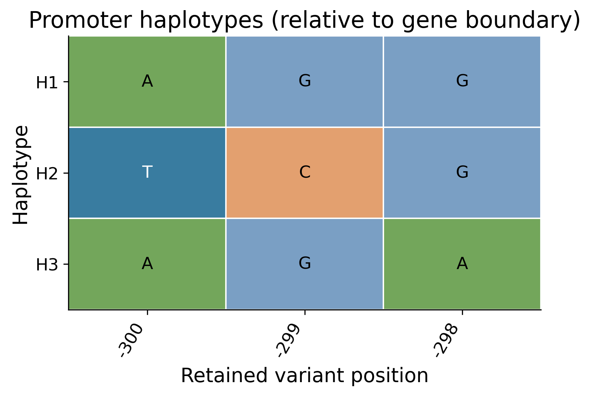
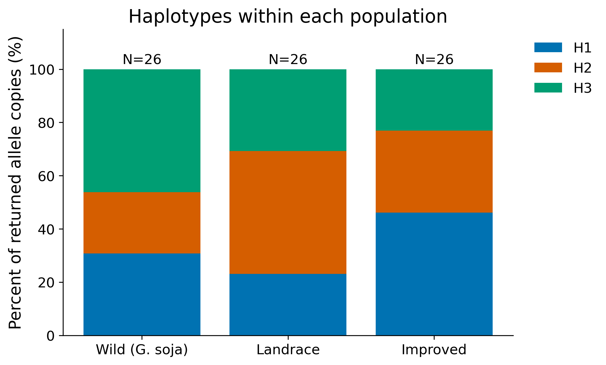

# Soybean Haplotype Analysis

一个面向生信新手的 Codex skill：给出大豆基因及研究角色，完成有来源记录的单倍型分析、统一风格科研图和中文解读。

**靶基因 → 启动子；转录因子 → CDS／蛋白。** 同一个基因在不同调控关系中可能有不同角色，按本次科学问题选择。

## 安装到 Codex

Windows PowerShell：

```powershell
git clone https://github.com/Si-Huang/soybean-haplotype-analysis.git "$env:USERPROFILE\.codex\skills\soybean-haplotype-analysis"
```

macOS / Linux：

```bash
git clone https://github.com/Si-Huang/soybean-haplotype-analysis.git ~/.codex/skills/soybean-haplotype-analysis
```

自定义 `CODEX_HOME` 时安装到其 `skills` 子目录。重新开启 Codex 会话后直接说：

```text
使用 $soybean-haplotype-analysis 分析 SoyZH13_13G319900（LOX1w），
它是我的靶基因。请完成启动子单倍型、群体频率、网络和可用表型分析，
用中文解释结果，输出到当前项目的新目录。
```

```text
使用 $soybean-haplotype-analysis 分析转录因子 SoyZH13_15G055900（SVPj），
做 CDS 和蛋白单倍型，先核实转录本，使用固定绘图风格。
```

不必先学命令。助手负责检查依赖、执行、核对来源并解释；角色、版本或表型含义不明确时会询问必要信息。

## 能完成什么

|模块|条件|结果|
|---|---|---|
|启动子单倍型|靶基因；默认注释基因边界上游 2 kb|位点矩阵、类型及来源映射|
|CDS／蛋白单倍型|TF、匹配转录本与已验证完整 CDS|CDS 矩阵、联合 SNP 翻译、蛋白归并、可变残基图|
|群体分布|野生／地方／改良群体拷贝数|两种分母的百分比图和源表|
|群体关联|独立材料能唯一归属类型|适用的 χ²／Fisher／固定边际 Monte Carlo、效应量和本次 BH|
|关系网络|明确的保留位点状态|Hamming 距离最小生成树；非 TCS 或祖先重建|
|地理分布|材料真实经纬度|坐标散点及覆盖率；无坐标不画假地图|
|分类／分级表型|逐材料、逐字段记录|有效 n、类别比例、冲突和缺失审计|
|结构域|有来源的蛋白坐标表|结构域与可变位点示意|
|motif／环境／连续性状关联|另有匹配输入和研究设计|按扩展指南由助手另行分析；不属于内置自动脚本|

默认常见变异 MAF ≥ 0.05、位点缺失率 ≤ 0.10、最小类型拷贝数 5。它们是起始约定，需要结合样本和问题调整。低频功能候选不能因默认阈值而被宣布“不存在”。

在线抓取目前支持 **SoyOmics 的 ZH13.v2／SoyZH13 编号**。其他大豆版本可使用规范本地输入；不同编号之间必须先验证映射。在线服务的可用性、分相来源与过滤限制会影响结果，原始响应和请求参数随输入保存。

## 无真实数据也能练习

在仓库根目录运行；Python 3.11+。Windows 可将 `python` 换成自己的 Python 完整路径：

```bash
python -m venv .venv
```

Windows：`.venv\Scripts\Activate.ps1`；macOS/Linux：`source .venv/bin/activate`。随后：

```bash
python -m pip install -r requirements.txt
python scripts/make_demo.py --out demo/inputs
python scripts/analyze.py --input demo/inputs/target --phenotypes demo/inputs/target/phenotypes.csv --out demo/results-target
python scripts/analyze.py --input demo/inputs/tf --phenotypes demo/inputs/tf/phenotypes.csv --domains demo/inputs/tf/domains.csv --out demo/results-tf
```

打开 `report_zh.md`，再看 `figures` 里的图和同目录 CSV。练习数据完全合成，不是实际基因结果。输入与结果目录须为空；重跑换一个新目录以避免混淆。





图像仅展示合成练习的样式。统一导出 PDF、SVG 和 300 dpi PNG；轴标题默认 14 pt，刻度 12 pt，并随画布调整，优先保证最终尺寸可读。

## 在线实际分析

```bash
python scripts/fetch_soyomics.py --gene SoyZH13_13G319900 --role target --symbol LOX1w --out data/LOX1w-promoter
python scripts/analyze.py --input data/LOX1w-promoter --out results/LOX1w-promoter
python scripts/fetch_soyomics.py --gene SoyZH13_15G055900 --role tf --symbol SVPj --out data/SVPj-CDS
python scripts/analyze.py --input data/SVPj-CDS --out results/SVPj-CDS
```

TF 首次下载官方 GFF；之后可通过 `--gff FILE` 复用匹配版本文件。默认 `.m1` 转录本，指定其他转录本用 `--transcript`。网络失败或接口变化会停止获取并保留已下载的响应，不会用练习数据代替真实结果。

## 读结果之前

- **等位拷贝 ≠ 独立材料 ≠ 表型测定记录**。频率描述与正式检验使用不同单位，见图注和源表。
- **缺失 ≠ 0**。表型 n=0 不代表感病；R/ER/N/S 必须按原始数据字典解释。
- 自动蛋白类型仅由保留 SNP 定义；Indel、参考不匹配、未知分相／不完整 CDS 不能强行翻译。
- 频率差异不直接证明自然选择；motif 预测不证明结合；SMV 记录不替代其他病毒接种实验。
- 实际数据、个人目录和未发表样本不随 skill 发布。`data/`、`results/`、`demo/` 默认不进入 Git。

详见 [新手指南](references/beginner-guide.md)、[输入与来源](references/inputs-and-sources.md)、[统计与扩展](references/analysis.md)、[绘图规范](references/figure-style.md)。

## 开发检查

```bash
python -m unittest discover -s tests -v
```

测试覆盖正负链、跨外显子 phase、同密码子联合替换、缺失与冲突、材料去重、稀疏列联表检验以及两个分支的端到端输出。GitHub Actions 自动运行。在线接口独立于这些测试，应在实际使用时核实。

代码采用 [MIT License](LICENSE)。外部数据库数据仍遵循其来源条款；引用研究结果时还应引用原数据库和使用的方法。
